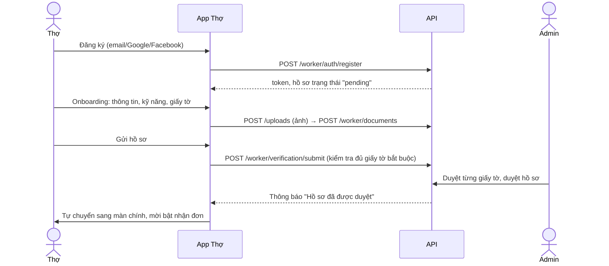
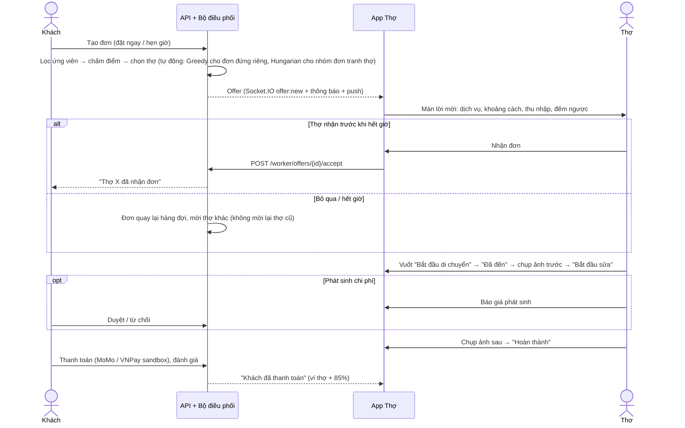
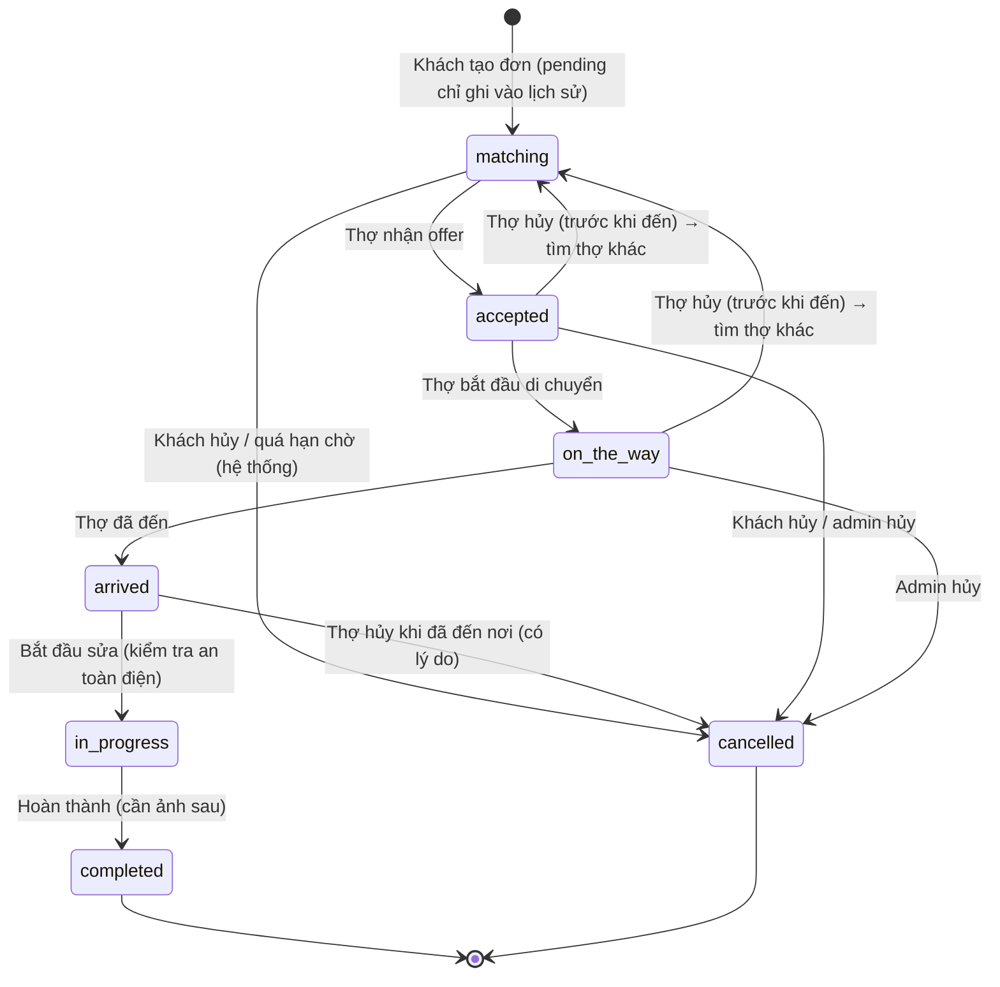
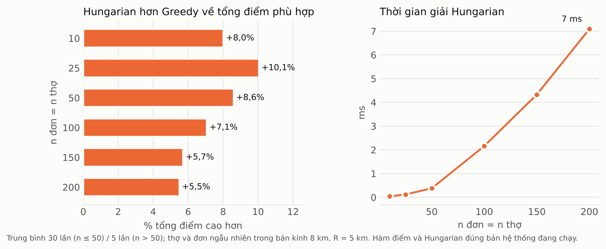

# Thiết kế App Thợ & thuật toán ghép cặp — THỢ NHANH

> Phần việc của **Thành viên B**: App Thợ (React Native/Expo) + API app thợ trong backend **Node.js (Express) của nhóm** + thuật toán ghép cặp (tức thời, theo lô, tự động hybrid) và bộ điều phối.
> Mã nguồn backend: gói `backend-node` (`src/routes/worker`, `src/services/worker`, `src/services/matching`, `src/matching`); tài liệu chi tiết: `backend-node/docs/WORKER_API.md`, `MATCHING.md`, `TICH_HOP_THANH_VIEN_B.md`.
> Tài liệu này viết để dùng lại cho Chương 3 (phân tích – thiết kế), Chương 4 (xây dựng) và Chương 5 (kiểm thử – thực nghiệm) của báo cáo.

Mục lục

1. [Phạm vi và các quyết định chính](#1-phạm-vi-và-các-quyết-định-chính)
2. [Tham khảo các ứng dụng tương tự](#2-tham-khảo-các-ứng-dụng-tương-tự)
3. [Use case của thợ](#3-use-case-của-thợ)
4. [Các luồng nghiệp vụ chính](#4-các-luồng-nghiệp-vụ-chính)
5. [Máy trạng thái đơn hàng](#5-máy-trạng-thái-đơn-hàng)
6. [Thuật toán ghép cặp](#6-thuật-toán-ghép-cặp)
7. [Bộ điều phối (dispatcher)](#7-bộ-điều-phối-dispatcher)
8. [Thu nhập, ví và hoa hồng](#8-thu-nhập-ví-và-hoa-hồng)
9. [Thay đổi cơ sở dữ liệu](#9-thay-đổi-cơ-sở-dữ-liệu)
10. [API cho App Thợ](#10-api-cho-app-thợ)
11. [Kiến trúc App Thợ](#11-kiến-trúc-app-thợ)
11b. [Thiết kế giao diện](#11b-thiết-kế-giao-diện)
12. [Kiểm thử](#12-kiểm-thử)
13. [Thực nghiệm so sánh các chế độ ghép cặp](#13-thực-nghiệm-so-sánh-các-chế-độ-ghép-cặp)
14. [Hạn chế và hướng phát triển](#14-hạn-chế-và-hướng-phát-triển)

---

## 1. Phạm vi và các quyết định chính

| Chủ đề | Quyết định | Lý do |
|---|---|---|
| Ngành nghề | Chỉ **thợ điện**. Danh mục = 4 nhóm chuyên môn trong nghề điện: Sửa chữa điện, Lắp đặt thiết bị điện, Đồ điện gia dụng, Đi dây & tủ điện (13 dịch vụ) | Nhóm chốt thu hẹp phạm vi. Vẫn chia nhóm (không gộp 1 danh mục "Điện") để thợ chỉ nhận nhóm việc mình làm được. Số năm kinh nghiệm là **1 con số chung** của thợ, áp cho mọi nhóm đã chọn (khai từng nhóm vừa rườm rà vừa dễ lệch với con số ở hồ sơ). Code không gắn cứng tên danh mục. |
| Đăng nhập | Email + mật khẩu, Google, Facebook. **Bỏ SMS OTP** | SMS OTP tốn phí. Quên mật khẩu bằng mã 6 số gửi qua email (SMTP miễn phí, VD Gmail). |
| Bản đồ | **MapLibre GL + OpenFreeMap** (bản đồ vector), tự chuyển sang **Leaflet + OpenStreetMap** nếu máy không có WebGL hoặc không tải được | Miễn phí, không cần API key, không giới hạn lượt. Không dùng CARTO: từ 08/2026 CARTO bắt buộc API key (ảnh nền hiện chữ "API KEY REQUIRED"). Máy chủ ảnh của OpenStreetMap từ 03/2026 bắt buộc có Referer nên chỉ dùng làm dự phòng (app gửi Referer + User-Agent đúng chính sách). Thư viện bản đồ nhúng sẵn trong app (không phụ thuộc CDN). Dẫn đường: mở Google Maps/Apple Maps của máy. |
| Ai chọn thợ? | **Hệ thống gửi lời mời (offer) cho thợ**, thợ nhận/bỏ qua — giống Grab, bTaskee | Khách không phải tự chọn trong danh sách; thuật toán ghép cặp thực sự quyết định. Chế độ ghép (mặc định **tự động**; tức thời / theo lô để thực nghiệm) do **admin** cấu hình, không do khách chọn. |
| Realtime | **Socket.IO** (cùng kênh với app khách: `offer:new`, `offer:closed`, `order:updated`, `message:new`, `notification:new`) + hỏi định kỳ làm dự phòng + **Expo Push** (khi có development build) | Lời mời đến ngay (thợ chỉ có 30–60 giây để trả lời); mất kết nối socket thì polling vẫn giữ app đúng. |
| Tiền | **Chỉ thanh toán online** (MoMo / VNPay sandbox). Khách trả xong → ví thợ cộng thực nhận (85%) → thợ rút về ngân hàng. Không tiền mặt, không nạp ví, ví không âm | Tiền mặt khó kiểm soát (thợ cầm tiền, nền tảng phải đòi hoa hồng, ví âm, đối soát), không cần cho phạm vi đồ án. Khách còn đơn chưa trả thì chưa đặt được đơn mới, nên thợ không bị "quỵt". |
| Backend | Viết trong backend **Node.js/Express + PostgreSQL/PostGIS của nhóm** (raw SQL `pg`, migration SQL `node-pg-migrate`), theo đúng quy ước sẵn có: lỗi `{message}`, danh sách `{items,total,page,pageSize}`, Socket.IO phòng `user:<id>` | Nhóm chốt dùng Node.js; app thợ, app khách, web quản trị dùng chung 1 CSDL và 1 API. |
| Đóng gói | Mỗi phần là 1 Docker image; `docker compose up` là chạy | Theo yêu cầu nhóm. |

## 2. Tham khảo các ứng dụng tương tự

| Ứng dụng | Điều học được | Áp dụng trong App Thợ |
|---|---|---|
| Grab Driver / Be Driver | Lời mời nhận chuyến toàn màn hình, đếm ngược, hiện **thu nhập thực nhận** trước khi nhận; vuốt để chuyển trạng thái; ví tài xế bị trừ hoa hồng khi khách trả tiền mặt | Màn lời mời (OfferCenter) hiện ở mọi màn, rung máy, vòng đếm ngược, khoảng cách + ETA, thu nhập dự kiến; nút **vuốt để xác nhận** (tránh bấm nhầm khi đang đi đường). Không lấy mô hình ví âm của Grab vì Thợ Nhanh chỉ nhận thanh toán online |
| bTaskee, Rada (đối tác dịch vụ tại nhà) | Trang chủ là **việc và lịch hẹn**, không phải bản đồ; công việc đặt lịch trước; khu vực nhận việc | Trang chủ = trạng thái nhận đơn + việc đang làm + số liệu hôm nay + lịch hẹn; bản đồ chỉ ở lời mời và chi tiết việc. Đơn hẹn trước: lời mời ghi rõ giờ hẹn, thợ tự quyết; hệ thống chặn trùng lịch; chỉ được xuất phát trong 60 phút trước giờ hẹn |
| Urban Company (partner app) | Chuẩn hoá quy trình tại nhà khách: ảnh trước/sau, báo giá phát sinh cần khách đồng ý, chỉ số hiệu suất (tỷ lệ nhận, tỷ lệ hủy, đánh giá) | Ảnh "sau" bắt buộc trước khi hoàn thành, ảnh "trước" được nhắc chụp khi bắt đầu sửa; báo giá phát sinh khách duyệt trong app; màn Hiệu suất 30 ngày |

Nguyên tắc UX rút ra cho thợ (người dùng đang di chuyển, tay bẩn, ngoài trời):
- Nút to, chữ to, tương phản cao; thao tác chính ở nửa dưới màn hình; 1 hành động chính mỗi màn.
- Hiện **tiền thợ thực nhận** (đã trừ hoa hồng), không chỉ giá khách trả.
- Không lộ số điện thoại của khách khi chưa nhận việc (lời mời chỉ hiện tên gọi, địa chỉ, khoảng cách); số điện thoại chỉ hiện khi đang làm đơn và 7 ngày sau khi hoàn thành (để liên hệ bảo hành).
- Mọi thao tác có hậu quả (hủy đơn, xác nhận đã đến khi còn xa > 500 m, rút tiền) đều có hộp thoại xác nhận.
- Lỗi mạng không làm mất thao tác: hiển thị trạng thái lỗi + nút thử lại; dữ liệu tự làm mới khi app quay lại.

## 3. Use case của thợ

| Mã | Use case | Ghi chú |
|---|---|---|
| UC01 | Đăng ký tài khoản thợ (email + mật khẩu) | Hoặc Google / Facebook (tự liên kết nếu trùng email) |
| UC02 | Đăng nhập / đăng xuất / quên mật khẩu / đổi mật khẩu | Mã quên mật khẩu 6 số, hết hạn 15 phút, tối đa 5 lần nhập sai |
| UC03 | Hoàn thiện hồ sơ nghề nghiệp (onboarding) | Tự mở sau khi đăng ký; có nút X để bỏ qua, vào app trước và nộp sau. 4 bước: thông tin cá nhân (SĐT, số năm kinh nghiệm) → nhóm dịch vụ → giấy tờ → gửi duyệt |
| UC04 | Tải giấy tờ xác minh | CCCD mặt trước/sau, ảnh chân dung (bắt buộc), chứng chỉ nghề điện (khuyến khích) |
| UC05 | Theo dõi kết quả duyệt hồ sơ | App báo ngay khi admin duyệt / từ chối / bỏ duyệt; bị từ chối thì thấy lý do & tải lại giấy tờ |
| UC06 | Bật/tắt nhận đơn | Chỉ khi đã duyệt. Chưa duyệt bấm bật → báo nộp giấy tờ (chưa gửi) hoặc chờ quản trị viên duyệt (đã gửi). App gửi vị trí định kỳ khi đang bật |
| UC07 | Nhận lời mời đơn & chấp nhận / bỏ qua | Đếm ngược; bỏ qua có chọn lý do |
| UC08 | Xem danh sách công việc (đang làm kể cả lịch hẹn / hoàn thành / đã hủy) | |
| UC09 | Thực hiện đơn: đang đến → đã đến → bắt đầu sửa → hoàn thành | Vuốt để xác nhận; dẫn đường; gọi / chat với khách. Đơn hẹn trước chỉ bắt đầu di chuyển được trong 60 phút trước giờ hẹn |
| UC10 | Chụp ảnh trước/sau khi sửa | Ảnh "sau" bắt buộc trước khi hoàn thành; ảnh "trước" được nhắc khi bắt đầu sửa |
| UC11 | Gửi báo giá phát sinh | Chỉ sau khi đã đến nơi xem hiện trạng; khách duyệt/từ chối trên app khách; thợ có thể rút lại báo giá đang chờ |
| UC12 | Theo dõi khách thanh toán | Khách trả MoMo / VNPay trên app khách; trả xong thì 85% vào ví thợ, app thợ báo ngay. Không nhận tiền mặt |
| UC13 | Hủy đơn đã nhận (có lý do) | Trước khi đến nơi: đơn quay lại hàng đợi tìm thợ khác; đã đến nơi: hủy đơn |
| UC14 | Báo cáo sự cố (khách vắng mặt, không thanh toán, tranh chấp...) | Tạo khiếu nại cho admin |
| UC15 | Chat với khách theo đơn | |
| UC16 | Xem thu nhập theo ngày/tuần/tháng + biểu đồ | |
| UC17 | Quản lý ví: số dư, lịch sử giao dịch, rút tiền | Rút tiền tối thiểu 50.000đ, cần tài khoản ngân hàng |
| UC18 | Xem lịch hẹn sắp tới, được nhắc trước giờ hẹn 60 phút | Không có khung giờ làm việc theo tuần: bật = nhận đơn, tắt = nghỉ (xem mục 11c) |
| UC19 | Cài đặt khu vực & bán kính nhận việc (chọn trên bản đồ) | |
| UC20 | Xem đánh giá của khách & hiệu suất 30 ngày | |
| UC21 | Nhận thông báo (trong app + push) | |
| UC22 | Xem bản đồ lớn của đơn (vị trí thợ – nhà khách) | Chạm bản đồ nhỏ ở chi tiết việc để mở toàn màn hình; nút căn lại khung, dẫn đường |
| UC23 | Kiểm tra an toàn điện trước khi sửa | 4 mục bắt buộc; server lưu thời điểm xác nhận (`safety_checked_at`) |
| UC24 | Báo giá nhanh từ bảng giá vật tư/công tham khảo | Thợ vẫn sửa được nội dung, số tiền; khách phải đồng ý |
| UC25 | Xem hạng thợ và điều kiện lên hạng | Đồng / Bạc / Vàng / Kim cương — chỉ hiển thị, không ảnh hưởng ghép đơn |
| UC26 | Chia sẻ địa chỉ đang làm cho người thân | Mở hộp chia sẻ của điện thoại (Zalo, SMS...) |

Use case phía **admin** liên quan tới thợ (web quản trị của thành viên khác dùng API có sẵn + API mới):
duyệt/từ chối hồ sơ (đề xuất nhóm: duyệt theo từng giấy tờ), cấu hình matching (trọng số, chế độ, bán kính, số thợ mời mỗi đợt k, timeout, cửa sổ lô), xem trạng thái bộ điều phối, duyệt yêu cầu rút tiền.

## 4. Các luồng nghiệp vụ chính

### 4.1. Đăng ký → xác minh → được nhận việc



Hồ sơ bị từ chối → app hiện lý do từng giấy tờ, thợ tải lại → gửi lại. Thợ chưa duyệt **không** xuất hiện trong ghép cặp.

### 4.2. Nhận đơn và làm việc



### 4.3. Thanh toán và ví
Xem [mục 8](#8-thu-nhập-ví-và-hoa-hồng).

## 5. Máy trạng thái đơn hàng



| Từ | Sang | Ai | Điều kiện / tác động |
|---|---|---|---|
| matching | accepted | Thợ | Offer còn hạn; thợ không giữ việc "làm ngay" khác; khóa dòng đơn → ai nhận trước thắng, offer còn lại bị thu hồi (`offer:closed`) |
| accepted | on_the_way | Thợ | Báo khách thợ đang tới; bắt đầu gửi vị trí để khách theo dõi. Đơn hẹn: hệ thống nhắc thợ trước giờ hẹn 60 phút |
| on_the_way | arrived | Thợ | App hỏi lại nếu GPS còn cách > 500 m |
| arrived | in_progress | Thợ | **Bắt buộc** gửi `safety_confirmed=true` (thợ đã tick đủ checklist an toàn điện); server lưu `safety_checked_at`. App nhắc chụp ảnh hiện trạng |
| in_progress | completed | Thợ | Cần ≥ 1 ảnh "sau"; không còn báo giá chờ duyệt; tạo bảo hành 30 ngày; ghi thu nhập dự kiến |
| accepted/on_the_way | matching | Thợ hủy | Offer của thợ → `cancelled`; đơn vào lại hàng đợi, **không** mời lại thợ này |
| arrived | cancelled | Thợ hủy | Lý do bắt buộc, báo khách |
| matching/accepted | cancelled | Khách | Khách hủy được tới khi thợ bắt đầu di chuyển; lời mời đang mở bị đóng và báo ngay cho app thợ |
| matching | cancelled | Hệ thống | Quá `DISPATCH_MAX_WAIT_MINUTES` (đặt ngay, 15 phút) hoặc tới 15 phút trước giờ hẹn mà chưa có thợ |
| mọi trạng thái chưa xong | cancelled | Admin | Báo cho khách và thợ, tính lại trạng thái bận của thợ |

## 6. Thuật toán ghép cặp

### 6.1. Bài toán
Cho tập đơn đang chờ $O$ và tập thợ $W$. Cần chọn thợ gửi lời mời cho mỗi đơn sao cho khách chờ ít, thợ phù hợp (gần, uy tín, giá hợp lý, không quá tải) và — ở chế độ lô — **tổng độ phù hợp toàn hệ thống lớn nhất**.

Quy trình 3 bước, dùng chung cho cả 2 chế độ:

1. **Lọc không gian** (PostGIS `ST_DWithin` trên chỉ mục GiST, hàm `findCandidates` dùng chung với trang Mô phỏng của web quản trị): thợ trong bán kính tìm $R$ quanh đơn **và** khách nằm trong bán kính nhận việc của thợ.
2. **Lọc ràng buộc cứng** (thành viên B):
   - hồ sơ đã duyệt, tài khoản đang hoạt động, có kỹ năng đúng **nhóm** của dịch vụ;
   - vị trí còn mới (≤ `LOCATION_MAX_AGE_MINUTES` = 10 phút);
   - đơn đặt ngay: thợ đang `online` (rảnh); đơn hẹn trước: `online` hoặc `busy`;
   - không đang giữ lời mời khác (mỗi thợ tối đa 1 offer sống);
   - **chưa từng được mời đơn này** (ràng buộc UNIQUE(order_id, worker_id));
   - đơn hẹn: không trùng lịch hẹn khác của thợ trong ±120 phút (lời mời ghi rõ giờ hẹn để thợ tự quyết nhận hay không).
3. **Chấm điểm** Weighted Scoring rồi chọn theo chế độ.

### 6.2. Hàm điểm (Weighted Scoring)

5 tiêu chí đúng như web quản trị của nhóm đang hiển thị. Hàm `services/scoring.js` dùng chung cho trang Mô phỏng và bộ điều phối, nên điểm admin thấy = điểm hệ thống dùng thật:

$$S(o,w) = w_d\,s_d + w_t\,s_t + w_s\,s_s + w_a\,s_a + w_l\,s_l,\qquad \sum w = 1,\; s_\ast \in [0,1] \Rightarrow S \in [0,1]$$

| Tiêu chí | Công thức | Ý nghĩa |
|---|---|---|
| Khoảng cách $s_d$ | $\max(0,\,1 - d/R)$ | $d$: khoảng cách PostGIS thợ–khách, $R$: bán kính tìm của cấu hình |
| Tin cậy $s_t$ | `trust_score` ∈ [0,1]; thợ mới chưa có đơn/đánh giá (điểm = 0): **0,5** | Kết quả thuật toán Trust Score (thành viên A). Mức trung tính cho thợ mới để không bị xếp cuối mãi (cold start) |
| Kỹ năng $s_s$ | $\min(y, 10)/10$ | $y$: số năm kinh nghiệm của thợ (1 con số chung, khai ở Thông tin cá nhân; lưu đồng bộ vào `worker_skills.years` của mọi nhóm thợ nhận làm). Điều kiện "đúng nhóm" đã là ràng buộc cứng ở bước lọc |
| Nhận đơn $s_a$ | $\dfrac{\text{nhận} + 3}{\text{nhận} + \text{bỏ lỡ} + 3}$ trong 30 ngày | Làm mượt Bayes (3 lần nhận "ảo"); không tính lời mời bị đóng sớm vì thợ khác nhận / khách huỷ |
| Khối lượng $s_l$ | $1 - \min(k,5)/5$ | $k$: số đơn trong ngày — chia đều việc |

Trọng số mặc định $(w_d, w_t, w_s, w_a, w_l) = (0{,}35;\,0{,}30;\,0{,}15;\,0{,}10;\,0{,}10)$. Admin chỉnh trên web quản trị (bảng `matching_configs`, bản đang `is_active`). Hoà điểm thì thợ gần hơn đứng trước, rồi tới id nhỏ hơn (kết quả ổn định, kiểm thử được).

### 6.3. Chế độ 1 — Tức thời (Weighted Scoring + Greedy theo đợt)

```
khi có đơn mới o (hoặc đến hạn thử lại):
    C ← các thợ hợp lệ (bước 1 + 2), bỏ các thợ đã từng mời
    sắp xếp C giảm dần theo S(o, w)
    gửi offer cho top-k (k = max_offers, mặc định 1), hạn T = offer_timeout_seconds
    nếu C rỗng: thử lại sau DISPATCH_RETRY_SECONDS (20 s)
khi thợ nhận: khoá đơn → thợ đầu tiên nhận thắng → thu hồi các offer còn lại
khi hết T mà không ai nhận: đợt tiếp theo với các thợ xếp sau
quá deadline: hủy đơn, báo khách
```

Độ phức tạp mỗi đợt: $O(c\log c)$ với $c$ = số ứng viên sau lọc không gian.
Đánh đổi của $k$: $k$ lớn → chờ ghép ít hơn nhưng "ai nhanh tay thì được": thợ thắng thường ở xa hơn nên **thợ tới nơi chậm hơn**, điểm phù hợp TB giảm, làm phiền nhiều thợ hơn. Thực nghiệm mục 13 → mặc định $k = 1$.

### 6.4. Chế độ 2 — Theo lô (Batch Optimal Assignment, Hungarian)

Cứ mỗi `batch_window_seconds` (W), gom **mọi** đơn chế độ lô đang chờ (không có offer sống) và mọi thợ hợp lệ của chúng, dựng ma trận điểm $n \times m$:

$$\text{score}[i][j] = \begin{cases} S(o_i, w_j) & \text{nếu cặp hợp lệ}\\ \varnothing & \text{ngược lại}\end{cases}$$

Mục tiêu: chọn tập cặp không trùng hàng/cột sao cho (1) **số cặp hợp lệ lớn nhất**, rồi (2) **tổng điểm lớn nhất**.

Quy về bài toán gán chi phí nhỏ nhất chuẩn:

$$\text{cost}[i][j] = \begin{cases} 1 - S(o_i,w_j) \in [0,1] & \text{hợp lệ}\\ \mathrm{BIG} = \min(n,m) + 1 & \text{không hợp lệ}\end{cases}$$

*Vì sao đúng:* mọi lời giải gán đủ $\min(n,m)$ cặp. Tổng chi phí của toàn bộ cặp hợp lệ $\le \min(n,m) < \mathrm{BIG}$, nên thêm 1 cặp BIG luôn tệ hơn mọi cách dùng cặp hợp lệ → lời giải tối ưu dùng ít cặp BIG nhất (= nhiều cặp hợp lệ nhất). Với cùng số cặp hợp lệ $q$: $\sum(1 - S) = q - \sum S$ nên cực tiểu chi phí ⇔ cực đại tổng điểm. Cặp BIG trong lời giải bị bỏ (đơn chờ lượt sau).

*Cài đặt* (`src/matching/hungarian.js`, tự viết, không dùng thư viện): Hungarian với thế vị $u, v$ và đường tăng ngắn nhất kiểu Dijkstra; nếu $n > m$ thì chuyển vị. Độ phức tạp $O(n^2 m)$ với $n \le m$, tức $O(n^3)$ khi $n \approx m$. Kiểm chứng bằng **300 ma trận ngẫu nhiên so với vét cạn** (mục 12).

Mỗi đơn được gán → gửi offer cho đúng thợ được gán (hạn T). Thợ từ chối/hết hạn → đơn vào lượt lô kế tiếp, không mời lại thợ đó.

### 6.5. Vì sao 2 chế độ cho kết quả khác nhau — ví dụ
Đơn A đến trước, đơn B đến sau 2 giây. Thợ X cách A 1 km, cách B 1,2 km; thợ Y cách A 1,5 km, cách B 4,5 km (bán kính 5 km; chỉ xét tiêu chí khoảng cách cho dễ thấy).
- Greedy: A lấy X (điểm khoảng cách 0,8) → B chỉ còn Y (0,1). Tổng 0,9.
- Hungarian: A–Y (0,7) + B–X (0,76). Tổng 1,46 — cả hai khách đều có thợ gần.

### 6.6. Chế độ 3 — Tự động (hybrid, mặc định khi demo)
Hai chế độ trên mạnh ở hai hoàn cảnh khác nhau (xem thực nghiệm mục 13): vắng khách thì tức thời nhanh hơn vì không phải chờ cửa sổ lô; đông khách thì Hungarian tốt hơn hẳn vì tránh "đơn đến trước chiếm thợ tốt". Chế độ **auto** để hệ thống tự chọn ở **từng nhịp điều phối (2 giây)**, không cần admin canh giờ cao điểm:
1. Gom các đơn đang chờ (chưa có lời mời còn hạn), xếp hạng ứng viên hợp lệ của từng đơn như 2 chế độ kia.
2. Chia đơn thành **nhóm tranh chấp**: hai đơn chung ít nhất 1 thợ ứng viên thì cùng nhóm, nối bắc cầu — cài đặt bằng Union-Find (`src/matching/grouping.js`).
3. Nhóm chỉ có 1 đơn → không ai tranh thợ của đơn đó, ghép tham lam đã tối ưu → **gửi ngay cho top-k** (như tức thời).
4. Nhóm ≥ 2 đơn → **Hungarian trên riêng nhóm đó**, mỗi đơn 1 lời mời. Các nhóm độc lập nên giải riêng cho cùng kết quả với giải chung mà ma trận nhỏ hơn.

Đơn ghi lại chế độ **thực tế** đã dùng (`orders.matching_mode`, `order_offers.mode` = `instant` | `batch`) để thống kê. Admin vẫn chọn được 1 trong 3 chế độ ở web quản trị (VD ép `batch` để thực nghiệm).

## 7. Bộ điều phối (dispatcher)

Vòng chạy nền khởi động cùng API (`src/services/matching/dispatcher.js`), mỗi `DISPATCHER_TICK_SECONDS` (2 s). Hàng đợi là bảng `order_dispatches` (lần thử kế tiếp, hạn chót, số đợt, số lời mời):

1. Hết hạn các offer quá giờ → đơn tương ứng được thử lại ngay; đóng offer của đơn đã huỷ; nhận các đơn "mồ côi" (tạo bằng script/trước khi có tính năng).
2. Chế độ tức thời: gửi đợt kế tiếp cho các đơn đến hạn.
3. Chế độ tự động: chia nhóm tranh chấp → Greedy top-k / Hungarian. Chế độ lô: đủ W giây thì chạy 1 lượt Hungarian.
4. Hủy đơn quá hạn chờ; mỗi 10 s đồng bộ cờ bận (lịch hẹn tới gần), mỗi 30 s nhắc thợ trước giờ hẹn 60 phút.

An toàn đồng thời:
- **Khoá advisory PostgreSQL** cho mọi quyết định điều phối (`pg_advisory_xact_lock`) → 2 đơn không thể cùng "giành" 1 thợ.
- **Leader lock** (`pg_try_advisory_lock` trên 1 kết nối riêng) → chạy nhiều tiến trình Node / nhiều container thì chỉ 1 bộ điều phối hoạt động.
- Nhận offer khoá dòng đơn (`SELECT … FOR UPDATE`) → đúng 1 thợ thắng; các offer còn lại của đơn → `expired`.

## 8. Thu nhập, ví và hoa hồng

Hoa hồng nền tảng $c = 15\%$ (`COMMISSION_RATE`). Với tổng tiền đơn $P$ (giá gốc + báo giá phát sinh đã duyệt):

| Khách trả | Ghi nhận | Ví thợ |
|---|---|---|
| Online (MoMo/VNPay sandbox) — cách duy nhất | Nền tảng thu $P$ | **+ (P − cP)** (thực nhận) |

Ví dụ: đơn 400.000đ → khách trả 400.000đ qua MoMo → ví thợ +340.000đ, nền tảng giữ 60.000đ.
**Không nhận tiền mặt** (API thanh toán từ chối `cash`): nền tảng không phải đòi hoa hồng từ thợ, ví thợ không bao giờ âm, mọi khoản tiền đều có giao dịch đối soát được. Đổi lại phải chặn khách "quỵt": khách còn đơn đã hoàn thành mà chưa trả thì **chưa đặt được đơn mới**, app thợ hiện "Chờ khách thanh toán qua app" kèm số tiền sẽ vào ví.
Rút tiền: ≥ 50.000đ, không vượt số dư khả dụng, cần tài khoản ngân hàng; bản demo tự duyệt (`WITHDRAWAL_AUTO_APPROVE=true`), admin vẫn có API duyệt/từ chối.
Số dư nằm ở `workers.wallet_balance` (bảng của nhóm); mỗi biến động ví là 1 dòng `worker_transactions` có `balance_after` (sổ cái, UNIQUE theo đơn + loại để không ghi trùng). Phần ghi ví được gọi ngay trong `settlePayment` của app khách (cùng transaction), nên mỗi đơn chỉ cộng thực nhận đúng 1 lần.

## 9. Thay đổi cơ sở dữ liệu

Migration `backend-node/migrations/1792200000000_worker-app-matching.sql` (node-pg-migrate, có phần `down`; Docker tự chạy khi khởi động). Chỉ **thêm** vào schema của nhóm, không đổi hay xoá cột có sẵn. Migration `1792300000000_kinh-nghiem-chung.sql` chỉ đồng bộ dữ liệu cũ: `worker_skills.years` = `workers.experience_years`.

| Thay đổi | Mục đích |
|---|---|
| enum: `offer_status.cancelled`, `quote_status.cancelled`, `wallet_txn_type.topup` | Thợ huỷ sau khi nhận, thợ rút báo giá; `topup` (nạp ví) không còn dùng từ khi bỏ tiền mặt — PostgreSQL không xoá được giá trị enum nên vẫn để |
| `workers.submitted_at` | Thời điểm gửi hồ sơ (admin xếp hàng duyệt) |
| `orders.safety_checked_at` | Lưu vết thợ đã xác nhận kiểm tra an toàn điện lúc bắt đầu sửa |
| `order_offers.round`, `order_offers.reason` + index offer đang mở | Đợt mời; lý do đóng (`closed`, `offline`...) để không tính nhầm là thợ bỏ lỡ |
| `matching_configs.mode` (`instant`/`batch`/`auto`, mặc định `auto`), `matching_configs.max_offers` (k, mặc định 1) | Chế độ ghép do admin đặt |
| Bảng `order_dispatches` | Hàng đợi điều phối (chế độ, số đợt, số lời mời, lần thử kế tiếp, hạn chót) |
| `worker_transactions.withdrawal_id` + UNIQUE(order_id, type) | Ví thợ: liên kết lệnh rút, chống ghi trùng thu nhập/hoa hồng |
| Bảng `worker_bank_accounts`, `worker_withdrawals` | Tài khoản nhận tiền, lệnh rút |
| Bảng `password_reset_codes` | Mã quên mật khẩu (hash, hạn, số lần thử) |
| Bảng `order_photos` (`before`/`after`) | Ảnh trước/sau |
| Bảng `worker_location_logs` (GEOGRAPHY) | Vết di chuyển khi đang làm đơn |
| `complaints.reporter_id` | Báo cáo sự cố do thợ gửi (NULL = khiếu nại của khách) |

## 10. API cho App Thợ

Tiền tố `/api/worker`, xác thực `Authorization: Bearer <JWT>`; trả JSON trực tiếp, lỗi `{ "message": "..." }` tiếng Việt, danh sách `{items, total, page, pageSize}`; giờ ISO 8601 (UTC), app đổi sang giờ Việt Nam. Bảng đầy đủ: `backend-node/docs/WORKER_API.md`.

| Nhóm | Endpoint |
|---|---|
| Xác thực | `POST /auth/register`, `POST /auth/login` (email hoặc SĐT), `GET /auth/providers`, `POST /auth/google`, `POST /auth/facebook`, `POST /auth/forgot-password`, `POST /auth/reset-password`, `POST /auth/change-password`, `GET /auth/me` |
| Hồ sơ | `GET /me`, `PATCH /profile` (gồm số năm kinh nghiệm chung), `PUT /skills` `{ category_ids }` (nhóm dịch vụ), `GET/POST /documents`, `DELETE /documents/:id`, `POST /verification/submit`, `GET/PUT /bank-account` |
| Trang chủ & trạng thái | `GET /home`, `PATCH /availability`, `PATCH /location` |
| Lời mời | `GET /offers/current`, `POST /offers/:id/accept`, `POST /offers/:id/reject` |
| Công việc | `GET /orders?group=active\|completed\|cancelled\|history`, `GET /orders/:id`, `POST …/status`, `POST …/cancel`, `POST …/photos`, `DELETE …/photos/:photoId`, `POST …/extra-quotes`, `POST …/extra-quotes/:quoteId/cancel`, `POST …/report`, `GET /reports` |
| Chat | `GET/POST /orders/:id/messages`, `POST /orders/:id/messages/read` (chung bảng `messages` với app khách) |
| Thu nhập & ví | `GET /earnings/summary`, `GET /earnings`, `GET /wallet`, `GET /wallet/transactions`, `GET/POST /wallet/withdrawals` |
| Đánh giá & hiệu suất | `GET /reviews`, `GET /performance` |
| Khác | `GET /catalog/categories`, `GET /catalog/services`, thông báo `/notifications…`, `POST/DELETE /device-tokens` |
| Dùng chung | `POST /api/uploads` (ảnh ≤ 8 MB, nhận dạng theo nội dung file), `GET /media/…`, `GET /api/health` |
| Admin (mới) | `GET /api/admin/dispatch/status`, `PUT /api/admin/dispatch/mode`, `GET /api/admin/withdrawals`, `POST /api/admin/withdrawals/:id/approve\|reject` |

Realtime (Socket.IO cùng cổng 3000, `auth: { token }`): `offer:new`, `offer:closed`, `order:updated`, `message:new`, `notification:new`.

`GET /orders/:id` trả sẵn **cờ hành động** (`next_status`, `next_action`, `start_available_at`, `can_cancel`, `cancel_requeues`, `can_quote`, `can_add_photos`, `can_chat`, `can_report`, `needs_after_photo`, `needs_safety_check`, `has_pending_quote`, `awaiting_payment`, `amount_due`) → luật nghiệp vụ nằm ở server, app chỉ hiển thị, tránh lệch logic giữa app và backend.

`POST /orders/:id/status` nhận `{status, safety_confirmed}`; chuyển sang `in_progress` mà thiếu `safety_confirmed=true` → 400; đơn hẹn trước chuyển sang `on_the_way` sớm hơn 60 phút trước giờ hẹn → 400 (`start_available_at` cho app biết giờ sớm nhất). Báo giá phát sinh khi chưa đến nơi → 400.
`GET /earnings/summary` so sánh với **cùng kỳ** (VD tuần này mới tới Thứ 3 thì so với Thứ 2–Thứ 3 tuần trước), tránh kiểu "-78%" vô nghĩa khi tuần mới bắt đầu.

## 11. Kiến trúc App Thợ

- **Expo SDK 57** (React Native 0.86, React 19.2, TypeScript), chạy được Android, iOS và **web** (để demo bằng trình duyệt).
- Điều hướng: React Navigation 7 — Stack gốc gồm 2 bộ màn: *chưa đăng nhập* (Đăng nhập, Đăng ký...) và *đã đăng nhập* (4 tab *Trang chủ, Công việc, Thu nhập, Hồ sơ* + các màn chi tiết + Hoàn thiện hồ sơ). Bộ màn **không đổi theo trạng thái duyệt**: bản trước tách riêng bộ màn "chưa duyệt", admin bỏ duyệt lúc thợ đang mở 1 màn thì cả stack bị thay, bấm ← bị đơ.
- Dữ liệu: TanStack Query 5 + **Socket.IO** (`src/realtime/useRealtime.ts`): sự kiện từ server chỉ làm app tải lại đúng phần liên quan. Hỏi định kỳ làm dự phòng khi màn đang mở (lời mời 15 s khi socket đang nối / 3 s khi mất kết nối, chat 4 s, chi tiết đơn 6 s, trang chủ 8 s, danh sách việc 10 s); tự tải lại khi app quay về foreground hoặc socket nối lại.
- Vị trí: `expo-location`, gửi khi đang bật nhận đơn hoặc đang có việc (đang đến / đã đến / đang sửa).
- Bản đồ: 1 trang HTML chạy trong WebView (điện thoại) / iframe (web), giao tiếp `postMessage`. Trong trang: MapLibre GL (vector OpenFreeMap) hoặc Leaflet (OSM) — cùng 1 API nội bộ `setData({markers, circle, line, fit, padding, chromeBottom})`. Chỉ căn lại khung nhìn khi `fitKey` đổi để không giật khi vị trí cập nhật. Bản đồ chỉ có ở: lời mời nhận đơn, chi tiết việc khi còn phải di chuyển (chạm để mở toàn màn hình), khu vực nhận việc.
- Ảnh: `expo-image-picker` (chụp hoặc chọn), nén, tải lên `/api/uploads` (multipart).
- Thông báo: danh sách trong app + Expo Push (chỉ development build; Expo Go bỏ qua).
- Hộp thoại/Toast/Bottom sheet tự viết (`Overlay`) vì `Alert` của React Native không chạy trên web.
- Cấu hình API: chọn tự động (cùng máy với Expo/web, cổng 3000, tiền tố `/api`), ghi đè bằng `EXPO_PUBLIC_API_URL`, `API_URL` của Docker, hoặc nhập tay ở màn "Máy chủ" (bấm dòng "Máy chủ: …" ở cuối màn đăng nhập) — tiện khi đổi Wi-Fi lúc demo.

## 11b. Thiết kế giao diện

Mục tiêu: nhìn vào là biết app của **thợ điện**, dùng được ngoài nắng, một tay, khi đang đi đường.

| Thành phần | Lựa chọn | Lý do |
|---|---|---|
| Màu chủ đạo | Navy `#0B1F3A` | Màu vỏ tủ điện, dụng cụ cách điện; nghiêm túc, tương phản cao với chữ trắng |
| Màu nhấn duy nhất | Vàng an toàn `#FFC21A` | Màu biển báo an toàn điện; chỉ dùng cho hành động chính (Nhận đơn, Tiếp tục công việc, nút vuốt), số tiền nổi bật |
| Màu trạng thái | Xanh "có điện" `#18A957` (đang nhận đơn, hoàn thành, tiền vào), đỏ `#E5484D` (hủy, trừ tiền) | Quy ước quen thuộc |
| Chữ | **Be Vietnam Pro** (5 độ đậm), số dùng chữ số cùng độ rộng (tabular) | Font do người Việt thiết kế, dấu tiếng Việt chuẩn; tiền bạc thẳng hàng |
| Nhận diện | Họa tiết đường mạch điện rất mờ ở đầu trang màu navy (trang chủ, đăng nhập, hồ sơ chờ duyệt); không trang trí ở vùng nội dung | Có nét riêng của nghề điện mà không làm rối chỗ thợ cần đọc nhanh, ngoài nắng |
| Bật/tắt nhận đơn | Thẻ trạng thái với **công tắc gạt quen thuộc** (bấm cả thẻ cũng được). Ba trạng thái loại trừ nhau: *Đang tạm nghỉ* · *Đang nhận đơn* (kèm "đang chờ đơn quanh bạn") · *Đang có việc* (thẻ việc thay chỗ công tắc, ghi "Bận") | Bản trước dùng cầu dao mô phỏng: hiện cùng lúc ON/OFF, chiếm nửa màn hình và có lúc ghi "Đang nghỉ" khi thợ đang đi làm — đã bỏ |
| Bố cục chính | Trang chủ: đầu trang navy (tên, hạng, đánh giá, thông báo) + thẻ trạng thái/thẻ việc + số liệu hôm nay + lịch hẹn. Màn làm việc: bản đồ nhỏ đầu trang khi còn di chuyển (chạm để xem toàn màn hình), tự ẩn khi đã đến nơi; thanh tiến độ 5 bước (Nhận · Đi · Đến · Sửa · Xong); nút **vuốt để xác nhận** ở đáy | Thao tác chính ở nửa dưới màn hình; mỗi bước chỉ hiện thứ thợ cần lúc đó |
| Vùng an toàn | Chừa thanh trạng thái và thanh điều hướng của hệ thống (Android vẽ tràn viền, iPhone có thanh Home); thanh trạng thái chữ trắng trên nền navy | Kiểm tra trên khung điện thoại Android 393×851 có giả lập 2 thanh hệ thống |
| Ngôn ngữ | Câu ngắn, chủ động, gọi đúng tên việc ("Vuốt để bắt đầu sửa chữa", "Bạn nhận 127.500đ"); thông báo lỗi nói rõ phải làm gì | Người dùng là thợ, không phải dân công nghệ |

## 11c. Các quyết định thiết kế sau khi chạy thử trên điện thoại

| Quyết định | Lý do |
|---|---|
| **Bỏ bản đồ ở trang chủ** (và bản đồ nhiệt vùng nhiều đơn) | Mô hình app tài xế (Grab, Be) không hợp với thợ: tài xế chạy liên tục tìm khách, còn thợ làm mỗi việc 1–3 giờ, nhiều đơn hẹn trước. App đối tác dịch vụ tại nhà (bTaskee, Rada) đều để trang chủ là việc và lịch. Bản đồ chỉ hiện khi có đơn cụ thể |
| **Bỏ khung giờ làm việc theo tuần** | Thợ chỉ cần 1 khái niệm: bật = nhận đơn, tắt = nghỉ. Với đơn hẹn trước, lời mời ghi rõ giờ hẹn để thợ tự quyết; hệ thống vẫn chặn thợ đã có lịch trùng giờ (±120 phút); không ai online thì đơn tiếp tục tìm thợ tới 15 phút trước giờ hẹn |
| **Đơn hẹn chỉ xuất phát trong 60 phút trước giờ hẹn** | Tránh đơn hẹn ngày mai bị chuyển sang "đang di chuyển" từ hôm trước; cũng là lúc thợ bắt đầu bị tính là "bận" |
| **Báo giá phát sinh chỉ sau khi đến nơi** | Phải xem tận mắt hiện trạng mới báo được giá vật tư, công |
| **Bản đồ trong chi tiết việc tự ẩn khi đã đến nơi** | Lúc sửa thợ cần checklist an toàn, ảnh, báo giá; bản đồ chỉ chiếm chỗ |
| **Đang có việc vẫn chọn được "Nhận đơn mới khi xong việc này"** | Giống "nghỉ sau chuyến này" của app tài xế: thẻ việc thay chỗ công tắc, nhưng thợ vẫn quyết được xong việc thì nghỉ hay nhận tiếp |
| **Không cho thợ trả lời công khai đánh giá; đánh giá ≤ 3 sao có nút "Khiếu nại"** | Khách không chọn thợ theo đánh giá (hệ thống ghép), nên trả lời công khai không giúp gì mà dễ thành cãi nhau. Khiếu nại đi vào luồng khiếu nại của admin, admin đối chiếu ảnh trước/sau + tin nhắn rồi ẩn/giữ đánh giá |
| **Giấy tờ đã duyệt vẫn cập nhật được nhưng phải duyệt lại**: gửi ảnh mới thành bản chờ duyệt, ảnh cũ vẫn hiệu lực tới khi admin duyệt; hủy được bản chờ duyệt; CCCD/chân dung đã duyệt không gỡ được, chứng chỉ gỡ được | Thợ làm lại CCCD vẫn tự cập nhật trên app, không mất ngày nhận việc; mà kẻ chiếm tài khoản cũng không thay được ảnh người khác vì ảnh mới chưa có hiệu lực khi admin chưa đối chiếu (cách của app tài xế) |
| **Mỗi đơn tối đa 6 ảnh trước + 6 ảnh sau**, có bộ đếm "x/6"; ảnh được thu nhỏ (≤ 1600 px, JPEG) trước khi gửi | Đủ làm bằng chứng mà không làm chậm 4G; camera mới chụp ảnh 5–15 MB vượt giới hạn 8 MB của máy chủ |
| **Bấm ảnh để xem toàn màn hình, chụm 2 ngón để phóng to** | Admin/thợ cần đọc rõ giấy tờ, xem chi tiết chỗ hỏng |
| **Bản đồ chọn khu vực nằm trong trang cuộn: chạm vào bản đồ thì trang ngừng cuộn** | Trước đó kéo/chụm trên bản đồ lại cuộn cả trang |
| **Mọi bản đồ kéo/chụm được, có nút ⌖ căn lại thợ + khách**; bản đồ trong trang cuộn (chi tiết việc, khu vực nhận việc) khóa cuộn trang khi ngón tay đang chạm bản đồ; vẫn có "Xem bản đồ lớn" | Thợ muốn xem kỹ đường quanh nhà khách ngay ở màn làm việc |
| **Không vẽ đường thẳng nối thợ – khách**, chỉ 2 điểm | Đường chim bay dễ bị hiểu nhầm là đường đi; đường đi thật thì bấm "Dẫn đường" mở Google Maps |
| **Giá = công cơ bản theo bảng giá (biết trước) + phát sinh báo sau khi xem tận nơi (khách duyệt)**; trước khi hoàn thành ghi "tạm tính" | Giống app dịch vụ tại nhà (bTaskee, Urban Company): khách cần biết khoảng giá trước khi đặt, thợ biết trước thu nhập để quyết định nhận. Không để thợ "sửa xong mới tính": khách không còn quyền từ chối, dễ tranh chấp. Báo giá trước khi làm phần phát sinh mới là chuẩn |
| **Đơn đã hoàn thành hiện số sao ngay ở danh sách, chi tiết đơn có thẻ "Khách đánh giá"** (≤ 3 sao có "Khiếu nại đánh giá") | Thợ theo dõi phản hồi theo từng việc, không phải vào màn tổng hợp |
| **Chế độ ghép mặc định là tự động (hybrid)** | Kết quả thực nghiệm mục 13: tự chọn tức thời/Hungarian theo nhịp cho kết quả tốt ở cả lúc vắng và cao điểm |
| **Giữ đếm ngược ở lời mời** (mặc định 60 giây, admin chỉnh trong cấu hình ghép) | Hệ thống mời lần lượt từng nhóm thợ; thợ không trả lời thì đơn phải chuyển người khác, khách không thể chờ mãi. Grab, Be, Gojek đều làm vậy; 60 giây đủ cho thợ đang dở tay |
| **Báo giá phát sinh = danh sách mục như hóa đơn**: mục trong bảng giá chung **giá cố định**, chỉ chọn số lượng; mục ngoài bảng giá thì thợ tự nhập tên + đơn giá (ghi rõ "giá do thợ nhập"); bỏ các nút +50K/+100K | Bảng giá cố định giúp khách tin, tránh "hét giá"; nhưng vật tư khác hãng/khác loại vẫn phải báo được. Một báo giá gồm nhiều mục vì mỗi lúc chỉ được có 1 báo giá chờ duyệt |
| **Báo giá chờ duyệt không gạch ngang**, tô vàng + dòng "khách đồng ý thì bạn nhận thêm …, tổng …" | Gạch ngang chỉ dành cho khoản không tính (đã rút / bị từ chối); trước đây khoản chờ duyệt cũng bị gạch nên khó hiểu |
| **Bỏ tiền mặt: mọi đơn trả qua MoMo / VNPay; ví chỉ còn Rút tiền** (bản demo giả lập, không trừ tiền thật) | Tiền mặt buộc nền tảng đòi hoa hồng từ thợ (ví âm, nạp tiền, hạn mức nợ, đối soát) — phức tạp mà không cần cho đồ án. Thanh toán online thì nền tảng giữ tiền, cộng 85% vào ví, thợ rút về ngân hàng. Khách còn nợ đơn cũ thì chưa đặt đơn mới. Backend có sẵn API duyệt rút tiền cho web quản trị |
| **Chưa được duyệt vẫn vào app**; đăng ký xong tự mở màn Hoàn thiện hồ sơ, có nút X để bỏ qua | Thợ mới thường chưa mang theo CCCD lúc đăng ký; chặn ở cửa khiến họ bỏ app. Vào trước để xem app, nộp sau; chỉ chặn đúng chỗ cần chặn là bật nhận đơn, kèm câu báo nộp giấy tờ / chờ duyệt |
| **Số năm kinh nghiệm: 1 con số chung** (không khai riêng từng nhóm dịch vụ) | Khai từng nhóm vừa rườm rà vừa lệch với con số ở hồ sơ; thợ điện dân dụng thường làm cả 4 nhóm. Ràng buộc "đúng nhóm" vẫn do bước lọc đảm bảo |
| **Mật khẩu ≥ 8 ký tự, có cả chữ và số, chặn mật khẩu quá phổ biến**; không bắt chữ hoa / ký tự đặc biệt | Theo NIST SP 800-63B: độ dài và chặn mật khẩu hay bị đoán có ích hơn quy tắc ký tự (vốn khiến người dùng đặt "Abc@1234" rồi ghi ra giấy). Thêm "có chữ và số" để chặn mật khẩu toàn số (ngày sinh, SĐT) — kiểu hay gặp ở thợ. App hiện danh sách điều kiện tick xanh dần khi gõ |
| **Kéo xuống để tải lại ở mọi màn có dữ liệu**, và tự tải lại khi quay về màn (bấm ←, đổi tab) | Thói quen chung của app di động; không phải thoát ra vào lại mới thấy thay đổi. Kết quả duyệt hồ sơ, thanh toán còn được đẩy realtime |
| **"Hợp lệ" ở giấy tờ chỉ hiện khi cả hồ sơ đang được duyệt** | Hồ sơ bị từ chối / bỏ duyệt mà ảnh vẫn ghi "Hợp lệ" làm thợ hiểu nhầm; lúc đó ảnh hiện "Đã tải lên" hoặc "Bị từ chối" kèm lý do chung của admin |
| **Cỡ chữ của máy được tôn trọng nhưng tối đa 130%**; dòng có số tiền luôn để chữ bên trái co lại, số tiền giữ nguyên | Máy Oppo/Realme hay để chữ to: trước đó số tiền ở thẻ đơn bị đẩy ra ngoài khung |

## 12. Kiểm thử

| Loại | Nội dung | Kết quả |
|---|---|---|
| Đơn vị (`backend-node/test/algorithms.test.js`, không cần CSDL) | Hungarian so với **vét cạn** trên 300 ma trận ngẫu nhiên (có ô không hợp lệ, n≠m) — cùng số cặp, cùng tổng điểm; ví dụ kinh điển Greedy thua; ưu tiên nhiều cặp hơn điểm cao; ma trận rỗng/toàn ô không hợp lệ; ma trận lớn không bao giờ thua Greedy; Union-Find nối bắc cầu; hàm điểm 5 tiêu chí + xếp hạng ổn định; hạng thợ | 8/8 đạt |
| Tích hợp (`backend-node/test/worker-flow.test.js`, PostgreSQL/PostGIS thật, đi qua đúng API app thợ + app khách + admin) | đăng nhập email/SĐT, chặn sai vai trò; quên mật khẩu; Google/Facebook (giả lập phản hồi của Google/Meta); tải ảnh (chặn file giả ảnh); onboarding → admin từ chối → gửi lại → duyệt (thợ được báo); giấy tờ đã duyệt; **luồng đầy đủ**: offer → nhận → đi → đến → an toàn → báo giá → ảnh → xong → khách trả MoMo sandbox → ví cộng thực nhận → đánh giá → rút tiền; từ chối tiền mặt, nợ đơn thì không đặt được đơn mới; quy tắc mật khẩu; trạng thái duyệt + câu báo khi bật nhận đơn; kinh nghiệm chung đồng bộ mọi nhóm; admin bỏ duyệt → thợ bị tắt nhận đơn, lời mời bị thu hồi; bộ điều phối: từ chối → đợt sau, hết giờ, quá hạn → huỷ, thợ tắt app → lời mời đi tiếp; thợ huỷ → đơn quay lại hàng đợi; chế độ batch (Hungarian), **auto** (nhóm tranh chấp → Hungarian, đơn đứng riêng → Greedy); đơn hẹn: chặn trùng lịch, chỉ xuất phát trong 60 phút trước giờ hẹn; lọc kỹ năng / bán kính / vị trí cũ; thợ mới (cold start); khách / admin huỷ → app thợ được báo ngay; Socket.IO (`offer:new`, `worker:location`); API admin điều phối + rút tiền | 19/19 đạt (`npm test` chạy cả 2 file: 27/27) |
| End-to-end giao diện | Playwright + Chromium chạy bản web của app trên backend Node với CSDL seed mới: đăng nhập, bật nhận đơn, lời mời hiện kèm bản đồ, nhận đơn, vuốt qua các bước, **bị chặn khi chưa tick checklist an toàn**, báo giá từ bảng giá → khách duyệt, ảnh sau, hoàn thành, khách trả MoMo → thợ thấy tiền vào ví, khách đánh giá; đăng ký thợ mới → màn Hoàn thiện hồ sơ → bấm X → Trang chủ chặn bật nhận đơn kèm câu báo; admin bỏ duyệt khi thợ đang ở màn Giấy tờ → app báo ngay, bấm ← không đơ, duyệt lại → app chúc mừng; web quản trị của nhóm duyệt hồ sơ, đổi chế độ ghép | Đạt |
| Giao diện điện thoại | Chụp từng màn ở khung Android 393×851 có giả lập thanh trạng thái 32 px + 3 nút điều hướng 48 px | Đạt |
| Build | `tsc --noEmit`; `expo export` web/android | Đạt |

Chạy lại: trong `backend-node`, `npm test` (cần PostgreSQL/PostGIS, xem README của backend) và `npm run test:algo`.

## 13. Thực nghiệm so sánh các chế độ ghép cặp

Script: `backend-node/scripts/benchmark-matching.js` (`npm run benchmark -- --out <thư mục>`, khoảng 15 giây). Script dùng **đúng** hàm điểm, Hungarian, Greedy và Union-Find mà hệ thống đang chạy. Kết quả gốc (CSV, bảng) và biểu đồ: `docs/thuc-nghiem-ghep-cap/` (vẽ lại bằng `ve_bieu_do.py`).

### 13.1. Phần A — Bài toán gán tĩnh
n đơn & n thợ ngẫu nhiên trong bán kính 8 km, bán kính tìm R = 5 km, trust ~ Beta(8,2), kinh nghiệm 0–15 năm, tỷ lệ nhận đơn 0,6–1. Lặp 30 lần (n ≤ 50) / 5 lần (n > 50). Thời gian = nhỏ nhất của 5 lần chạy lại mỗi ma trận.

| n | Tổng điểm Greedy | Tổng điểm Hungarian | Cải thiện | Số cặp Greedy | Số cặp Hungarian | Thời gian Hungarian |
|---|---|---|---|---|---|---|
| 10 | 5,32 | 5,75 | +8,0% | 7,6 | 8,3 | 0,04 ms |
| 25 | 15,73 | 17,31 | +10,1% | 21,8 | 24,3 | 0,12 ms |
| 50 | 34,11 | 37,04 | +8,6% | 46,2 | 50 | 0,38 ms |
| 100 | 72,33 | 77,45 | +7,1% | 94,8 | 100 | 2,2 ms |
| 150 | 111,16 | 117,52 | +5,7% | 144 | 150 | 4,3 ms |
| 200 | 151,22 | 159,55 | +5,5% | 193,2 | 200 | 7,1 ms |



Nhận xét: Hungarian luôn ghép **nhiều đơn hơn** (đủ 100% khi có thể) và tổng điểm cao hơn 5,5–10%. Thời gian tăng nhanh theo n nhưng chỉ khoảng 7 ms với 200×200 — thừa đủ cho nhịp điều phối 2 giây.

### 13.2. Phần B — Mô phỏng vận hành
Mô phỏng sự kiện rời rạc bước 1 giây, 120 phút, **10 hạt giống** (báo cáo trung bình ± khoảng tin cậy 95%); 60 thợ; đơn đến theo Poisson; **10% thợ không phản hồi** (lời mời hết hạn sau 60 s), số còn lại trả lời sau 3–25 s và nhận với xác suất 0,85; khách chờ tối đa 15 phút; thợ bận = di chuyển (xe máy 20 km/h) + sửa 30–90 phút. Phản ứng của mỗi thợ với mỗi đơn cố định theo (hạt giống, đơn, thợ) nên mọi cấu hình gặp **cùng** dòng đơn và **cùng** quyết định của thợ. Ngoài thời gian chờ ghép, đo thêm **thợ tới nơi** = chờ ghép + thời gian thợ di chuyển — thời gian khách thật sự phải đợi.

| Kịch bản | Cấu hình | Tỷ lệ ghép | Chờ ghép TB | Điểm TB | Quãng đường TB | Thợ tới nơi TB |
|---|---|---|---|---|---|---|
| Thưa đơn (0,5 đơn/phút) | instant k=1 | 99,9% | 27,3 s | 0,766 | 1,82 km | 5,91 phút |
| | instant k=3 | 100% | **13,3 s** | 0,734 | 2,19 km | 6,81 phút |
| | batch W=10s | 99,9% | 32,5 s | 0,766 | 1,82 km | 5,99 phút |
| | batch W=30s | 99,9% | 43,9 s | 0,766 | 1,81 km | 6,17 phút |
| | **auto k=1** | 99,9% | 27,9 s | 0,766 | 1,82 km | **5,92 phút** |
| | auto k=3 | 100% | 14,0 s | 0,734 | 2,20 km | 6,83 phút |
| Vừa (1,5 đơn/phút) | instant k=1 | 71,9% | 315 s | 0,678 | 2,66 km | 13,23 phút |
| | instant k=3 | 71,7% | 306 s | 0,664 | 2,85 km | 13,65 phút |
| | batch W=10s | 71,9% | 207 s | 0,710 | 2,20 km | 10,06 phút |
| | **auto k=1** | 71,9% | 206 s | **0,710** | **2,20 km** | **10,02 phút** |
| | auto k=3 | 71,4% | **197 s** | 0,695 | 2,41 km | 10,52 phút |
| Cao điểm (3 đơn/phút) | instant k=1 | 38,3% | 456 s | 0,668 | 2,75 km | 15,85 phút |
| | instant k=3 | 38,0% | 448 s | 0,659 | 2,88 km | 16,11 phút |
| | batch W=10s | 39,3% | 264 s | 0,736 | 1,77 km | 9,73 phút |
| | **auto k=1** | 39,4% | 264 s | **0,736** | 1,78 km | **9,73 phút** |
| | auto k=3 | 39,1% | **254 s** | 0,726 | 1,92 km | 9,99 phút |


Độ nhạy theo tỷ lệ thợ không phản hồi (chế độ auto, thời gian thợ tới nơi TB; file `B_dong_khong-bo-lo.csv`, `B_dong_bo-lo-30.csv`):

| Không phản hồi | Thưa đơn k=1 / k=2 / k=3 | Cao điểm k=1 / k=2 / k=3 |
|---|---|---|
| 0% | **5,67** / 6,11 / 6,82 phút | **9,49** / 9,64 / 9,86 phút |
| 10% | **5,92** / 6,29 / 6,83 phút | **9,73** / 9,76 / 9,99 phút |
| 30% | **6,68** / 6,85 / 7,02 phút | **10,06** / 10,24 / 10,21 phút |

Nhận xét:
1. **Ít đơn**: tức thời và theo lô gần như như nhau về chất lượng; tức thời phản hồi nhanh hơn vì không phải đợi cửa sổ lô (W = 30 s: chờ 43,9 s so với 27,3 s).
2. **Đông đơn / cao điểm**: tối ưu toàn cục vượt trội tham lam — chờ ghép TB giảm ~35–42%, điểm phù hợp tăng 5–10%, quãng đường thợ đi giảm 17–35%, thợ tới nơi sớm hơn 3–6 phút. Lý do: tránh "đơn đến trước chiếm thợ tốt"; thợ đi quãng ngắn hơn nên rảnh sớm hơn, tăng sức chứa thật của hệ thống.
3. **Tự động (hybrid)** lấy được ưu điểm của cả hai mà không cần ai đổi cấu hình: lúc vắng gần như y hệt tức thời (27,9 s so với 27,3 s), lúc vừa và cao điểm ngang theo lô (cao điểm: điểm 0,736, thợ tới nơi 9,7 phút so với 15,9 phút của tức thời).
4. **k = 1 là mặc định.** Gửi cùng lúc cho nhiều thợ rút ngắn chờ ghép (thưa đơn: 14 s so với 28 s), nhưng thợ nhận nhanh nhất thường không phải thợ gần nhất → thợ tới nơi chậm hơn 0,3–1 phút, điểm phù hợp thấp hơn. Kết luận giữ nguyên khi tỷ lệ thợ không phản hồi là 0%, 10% hay 30%. Đổi lại k = 1 có đuôi chờ ghép dài hơn (P90 lúc thưa đơn: 66 s so với 20 s) — admin tăng k nếu muốn khách thấy "đã có thợ nhận" sớm hơn.
5. Tỷ lệ ghép ở kịch bản vừa / cao điểm bị giới hạn bởi **số thợ** (cung < cầu), không phải bởi thuật toán; W lớn hơn 5–10 s chỉ làm khách chờ thêm.

Giới hạn của mô phỏng: khoảng cách đường chim bay, tốc độ cố định, thời gian phản hồi không phụ thuộc khoảng cách, thợ phân bố đều, không mô phỏng huỷ sau khi nhận — các con số để so sánh tương đối giữa các cách ghép.

## 14. Hạn chế và hướng phát triển
- Push cần development build (EAS): app bỏ qua đăng ký push khi chạy trong Expo Go (Expo Go Android không còn hỗ trợ push từ xa từ SDK 53). Khi app đang mở, lời mời vẫn đến ngay qua Socket.IO.
- Đăng nhập Google trên điện thoại cần development build (Expo Go không dùng được redirect của Google); bản web dùng được ngay.
- Thanh toán, rút tiền là sandbox/mô phỏng.
- `trust_score` chưa được tính tự động (chờ thuật toán Trust Score của thành viên A); hiện dùng giá trị seed, thợ mới dùng mức trung tính 0,5 khi ghép.
- Mở rộng ghép cặp: chia bài toán theo khu vực (geohash) khi số đơn rất lớn; thêm tiêu chí thợ quen của khách; ước lượng thời gian tới nơi theo đường đi thật (OSRM) thay cho khoảng cách đường chim bay; học trọng số từ dữ liệu thật.
- Bản đồ dùng máy chủ cộng đồng miễn phí (OpenFreeMap, OpenStreetMap) — đủ cho đồ án/demo; chạy thật quy mô lớn nên tự dựng máy chủ ảnh bản đồ hoặc dùng gói trả phí.
- Bảng giá vật tư hiện cố định trong app; hướng phát triển: để admin quản lý bảng giá theo khu vực.
- Tối ưu pin: giảm tần suất gửi vị trí khi thợ đứng yên; chạy nền (background location) cần development build.
